<p align="center">
  
</p>

<p align="center">
  <a href="https://github.com/ishandutta2007/Awesome-Awesome-Awesome"></a><a href="https://discord.gg/jc4xtF58Ve"></a>
  <a href="https://github.com/ishandutta2007/Awesome-Simulation-Platforms-For-Robots/stargazers"></a>
  <a href="https://github.com/ishandutta2007/Awesome-Simulation-Platforms-For-Robots/network/members"></a>
  <a href="https://github.com/ishandutta2007/Awesome-Simulation-Platforms-For-Robots/pulls"></a>
  <a href="https://github.com/ishandutta2007/Awesome-Simulation-Platforms-For-Robots/blob/main/LICENSE"></a>
  <a href="https://github.com/ishandutta2007"></a>
</p>

---

# 🤖 Awesome Simulation Platforms For Robots

> **A rigorously curated directory of leading SaaS products, enterprise suites, and top-tier open-source robotics simulation engines.**  
> *Covering rigid/soft-body multi-physics solvers, GPU-parallelized reinforcement learning, photorealistic sensor modeling, autonomous driving, digital twins, and seamless sim-to-real transfer pipelines.*

Robot simulation allows robotics researchers, autonomous vehicle developers, and control engineers to prototype kinematics, train deep reinforcement learning policies, validate perception stacks, and execute regression testing at scale without risking expensive hardware.

---

## 📑 Table of Contents

- [📊 Sector Overview & Market Dynamics](#-sector-overview--market-dynamics)
- [🏢 SaaS & Hosted Commercial Platforms](#-saas--hosted-commercial-platforms)
- [🛠️ Open-Source Robotics Simulation Platforms](#️-open-source-robotics-simulation-platforms)
  - [⚡ Top Ranked Projects (by Stars_Count)](#-top-ranked-projects-by-star-count)
- [🎯 Choosing the Right Simulator (Use-Case Matrix)](#-choosing-the-right-simulator-use-case-matrix)
- [🔍 SEO & Keyword Taxonomy](#-seo--keyword-taxonomy)
- [🤝 How to Contribute](#-how-to-contribute)
- [📈 Star History](#-star-history)
- [☕ Support](#-support)
- [⚠️ Disclaimer](#️-disclaimer)

---

## 📊 Sector Overview & Market Dynamics

The global robotics simulation and digital twin software market is estimated at **$1.8B to $2.4B in 2025/2026**, projected to expand at an aggressive compound annual growth rate (**CAGR of ~16.5%**) to surpass **$4.5B by 2030**, driven by the explosion in humanoid robotics, autonomous mobile robots (AMRs), and GPU-accelerated reinforcement learning.

The sector exhibits **moderate fragmentation with strategic bifurcation**:
- **Legacy Industrial & Factory Automation**: Remains consolidated among multi-billion-dollar CAD/PLM powerhouses (*Siemens, Dassault Systèmes, MathWorks, Altair*), where high switching costs and integration with physical manufacturing assembly lines dominate.
- **AI-Native & Embodied Intelligence**: Rapidly evolving without a single "winner-take-all" monopoly. *NVIDIA Isaac Sim* has established dominant mindshare for GPU-accelerated synthetic data and RL training, while open-source foundational physics engines (*MuJoCo, Genesis, Gazebo, Drake, Bullet*) maintain crucial, non-negotiable roles across academia and production robotics stacks.

---

## 🏢 SaaS & Hosted Commercial Platforms

*Commercial cloud simulation suites, managed environments, and enterprise digital-twin platforms, **sorted in descending order of Company Size (Market Valuation / Revenue)***.

| 🏢 Platform / Product | 🌐 Company Size (Valuation / Revenue) | 🎯 Core Capabilities & Architecture | 🏷️ Starting Pricing | 🎁 Free Tier Limits |
| :--- | :--- | :--- | :--- | :--- |
| **[Microsoft Project AirSim (Azure)](https://microsoft.github.io/AirSim/)** | **~$3.1 Trillion Valuation**<br>*(~$245.1B Annual Revenue)* | Cloud-scale high-fidelity simulation on Microsoft Azure for autonomous aircraft, eVTOLs, and ground vehicles with synthetic sensor pipelines and multi-agent training. | **$0.90 / hour**<br>*(Azure NCas_T4_v3 GPU VM base compute rate for AirSim instances)* | **30-day free trial** with **$200 in Azure credits** + 12 months access to popular free services; open-source core binary engine is free forever. |
| **[NVIDIA Isaac Sim](https://developer.nvidia.com/isaac/sim)** | **~$3.0 Trillion Valuation**<br>*(~$130.5B Annual Revenue)* | Photorealistic, physically accurate robotics simulation built on NVIDIA Omniverse with PhysX 5, RTX ray tracing, ROS 2 integration, and Isaac Lab for high-throughput RL. | **$4,500 / GPU / year**<br>*(NVIDIA AI Enterprise / Omniverse Enterprise; or ~$1.00/GPU-hr on cloud partners)* | **Free forever** for individual developers and researchers running on local workstations with RTX GPUs; **90-day free trial** for enterprise cloud licenses. |
| **[AWS RoboMaker](https://aws.amazon.com/robomaker/)** | **~$2.0 Trillion Valuation**<br>*(~$620.1B Amazon / ~$105B AWS Revenue)* | Managed cloud robotics simulation platform running containerized ROS/ROS 2 and Gazebo workloads with automated CI/CD regression suites and world generation. | **$0.40 / SU / hour**<br>*(Simulation Unit per hour; 1 SU = 1 vCPU + 2 GB RAM)* | **Free tier: 25 Simulation Unit hours (SU-hrs) per month** for the first **12 months** on new AWS accounts. |
| **[Siemens Tecnomatix Process Simulate](https://www.sw.siemens.com/en-US/products/tecnomatix/)** | **~$160 Billion Valuation**<br>*(~$85.2B Annual Revenue)* | Comprehensive enterprise digital manufacturing and industrial robotics simulation suite with offline robot programming (OLP), PLC hardware-in-the-loop (HIL), and virtual commissioning. | **$6,500 / user / year**<br>*(Siemens Xcelerator Cloud Process Simulate named subscription; ~$540/month billed annually)* | **30-day free cloud trial** via Siemens Digital Industries Software test drive (includes pre-built industrial robotic welding and assembly cells). |
| **[Dassault Systèmes DELMIA Robotics](https://www.3ds.com/products-services/delmia/disciplines/robotics/)** | **~$45 Billion Valuation**<br>*(~$6.5B Annual Revenue)* | Cloud-based factory-scale robotics workcell simulation, kinematic reachability analysis, collision detection, and multi-robot arc welding / handling choreography on the 3DEXPERIENCE platform. | **$4,800 / user / year**<br>*(3DEXPERIENCE Cloud Robot Simulation & Programming role)* | **14-day free cloud trial** on the 3DEXPERIENCE platform with access to industrial robot libraries, kinematic solvers, and path verification. |
| **[MathWorks Robotics System Toolbox](https://www.mathworks.com/products/robotics.html)** | **~$15 Billion Valuation**<br>*(~$1.5B Annual Revenue — Private)* | Algorithm design and co-simulation environment connecting MATLAB/Simulink with Gazebo and ROS/ROS 2, featuring mobile robot kinematics, arm trajectory generators, and sensor models. | **$1,500 / year**<br>*(Commercial add-on license; or $3,000 perpetual) + $940/year MATLAB base; Academic licenses from $250/year* | **30-day free trial** with full unrestricted access to MATLAB, Simulink, Robotics System Toolbox, cloud compute, and dedicated technical support. |
| **[Altair EDEM + MotionSolve](https://altair.com/motionsolve)** | **$10.6 Billion Valuation**<br>*(Acquired by Siemens; ~$630M Annual Revenue)* | Discrete Element Method (DEM) bulk material simulation paired with multi-body dynamics (MBD) for simulating off-road robotic rovers, mining machinery, and granular soil interactions. | **$1.50 / unit / hour**<br>*(Altair One Cloud Units starting tier; or ~$10,000/year for standard Altair Units engineering bundle)* | **30-day free trial** on Altair One platform with initial units for running cloud solver simulations; **1-year free student edition** with node constraints. |
| **[Coppelia Robotics (CoppeliaSim)](https://www.coppeliarobotics.com/)** | **~$25 Million Valuation**<br>*(~$4.0M Annual Revenue — Boutique)* | Versatile robotics simulation environment with integrated development environment (IDE), distributed control architecture, and multi-physics engine plugins (Bullet, ODE, Vortex, Newton). | **€840 / year (~$910/year)**<br>*(CoppeliaSim PRO single-user annual; or €2,400 / ~$2,600 perpetual)* | **Free forever** for educational and non-commercial users (*CoppeliaSim Player / EDU* with complete GUI, Lua/Python API, and kinematics); **20-day trial** for PRO. |

---

## 🛠️ Open-Source Robotics Simulation Platforms

*Open-source simulation frameworks, multi-physics engines, and embodied AI benchmarks, **ranked in descending order by GitHub Stars_Count***.

### ⚡ Top Ranked Projects (by Stars_Count)

1. **[Genesis](https://github.com/Genesis-Embodied-AI/Genesis)** [](https://github.com/Genesis-Embodied-AI/genesis-world/stargazers)  
   **Ultra-fast next-generation physics platform for embodied AI and robotics.** Built from scratch with a unified multi-physics solver combining MPM, FEM, SPH, and articulated rigid/soft body dynamics. Claims up to 43M+ FPS on GPUs with differentiability for gradient-based policy optimization.

2. **[Microsoft AirSim](https://github.com/microsoft/AirSim)** [](https://github.com/microsoft/AirSim/stargazers)  
   **Open-source simulator for autonomous aerial drones and vehicles.** Built on Unreal Engine with realistic aerodynamic simulation, hardware-in-the-loop (HITL) flight controller integration (PX4/ArduPilot), LiDAR, depth cameras, and Python/C++ APIs.

3. **[MuJoCo](https://github.com/google-deepmind/mujoco)** [](https://github.com/google-deepmind/mujoco/stargazers)  
   **The gold standard physics engine for contact-rich manipulation and reinforcement learning.** Maintained by Google DeepMind as an Apache 2.0 open-source library. Features continuous-time dynamics, convex contact handling, multi-joint constraint solvers, and native Python bindings via `mujoco`.

4. **[Bullet Physics & PyBullet](https://github.com/bulletphysics/bullet3)** [](https://github.com/bulletphysics/bullet3/stargazers)  
   **Industry-proven real-time multi-body dynamics and collision detection SDK.** Widely utilized through PyBullet for robotics research, reinforcement learning benchmarks, inverse kinematics, virtual reality, and gym environments. Lightweight, C++ core, zero cloud dependencies.

5. **[CARLA](https://github.com/carla-simulator/carla)** [](https://github.com/carla-simulator/carla/stargazers)  
   **The leading open-source autonomous driving research simulator.** Built upon Unreal Engine 4/5, CARLA provides flexible sensor suites (RGB cameras, LiDAR, Radar, GNSS, IMU), dynamic weather conditions, urban traffic generation, OpenDRIVE map support, and ScenarioRunner test suites.

6. **[Open 3D Engine (O3DE)](https://github.com/o3de/o3de)** [](https://github.com/o3de/o3de/stargazers)  
   **Modular, Apache 2.0 licensed 3D simulation and game engine.** Developed under the Linux Foundation with Robotec.ai's ROS 2 Gem. Offers physically-based rendering (PBR), PhysX integration, high-fidelity sensor simulation, and multi-robot fleet distribution.

7. **[Isaac Lab](https://github.com/isaac-sim/IsaacLab)** [](https://github.com/isaac-sim/IsaacLab/stargazers)  
   **NVIDIA's flagship framework for robot learning and reinforcement learning.** Successor to Orbit and IsaacGymEnvs, Isaac Lab runs on top of Isaac Sim and Omniverse to deliver modular, high-throughput policy training across thousands of parallel environments for legged locomotion and manipulation.

8. **[dm_control](https://github.com/google-deepmind/dm_control)** [](https://github.com/google-deepmind/dm_control/stargazers)  
   **DeepMind's software stack for reinforcement learning in continuous control.** Provides standardized MuJoCo-based physics environments, procedural locomotion suites, and rich kinematic manipulation benchmarks.

9. **[Webots](https://github.com/cyberbotics/webots)** [](https://github.com/cyberbotics/webots/stargazers)  
   **Complete turnkey open-source robot simulation package.** Developed since 1998 by Cyberbotics (now Apache 2.0). Bundles a 3D editor, extensive robot libraries (Boston Dynamics Spot, Universal Robots, DJI, e-puck), sensor models, cross-platform ROS 2 interfaces, and multi-language controller support (Python, C++, Java, MATLAB).

10. **[Drake](https://github.com/RobotLocomotion/drake)** [](https://github.com/RobotLocomotion/drake/stargazers)  
    **MIT's model-based design, control, and mathematical verification toolkit.** Combines high-accuracy rigid-body multi-contact mechanics with non-linear optimization, mixed-integer trajectory planning, and formal system verification. Outstanding for manipulation and legged stabilization.

11. **[MuJoCo Menagerie](https://github.com/google-deepmind/mujoco_menagerie)** [](https://github.com/google-deepmind/mujoco_menagerie/stargazers)  
    **Google DeepMind's curated repository of validated robot models.** Contains production-quality, physically tuned MJCF XML models for prominent commercial and research platforms (Unitree H1/G1, ANYmal, Boston Dynamics Spot, Franka Emika Panda, KUKA iiwa, Shadow Hand).

12. **[ManiSkill](https://github.com/haosulab/ManiSkill)** [](https://github.com/haosulab/ManiSkill/stargazers)  
    **GPU-parallelized benchmark and simulation platform for generalizable manipulation.** Powered by SAPIEN, ManiSkill supports interactive articulated objects, GPU ray-traced visual observations, point clouds, and dense reward tracking for imitation and reinforcement learning.

13. **[Brax](https://github.com/google/brax)** [](https://github.com/google/brax/stargazers)  
    **Google's massively parallel differentiable physics engine in JAX.** Runs entirely on accelerators (TPUs and GPUs) without CPU-GPU communication overhead. Allows gradient-based trajectory optimization and training millions of physics steps per second.

14. **[Habitat-Lab](https://github.com/facebookresearch/habitat-lab)** [](https://github.com/facebookresearch/habitat-lab/stargazers)  
    **Meta AI's modular simulation platform for embodied AI agents in photorealistic 3D indoor scenes.** Achieves thousands of frames per second rendering Matterport3D, Gibson, and Replica datasets for point-goal navigation, visual SLAM, and mobile rearrangement.

15. **[IsaacGymEnvs](https://github.com/isaac-sim/IsaacGymEnvs)** [](https://github.com/isaac-sim/IsaacGymEnvs/stargazers)  
    **NVIDIA's high-speed end-to-end GPU physics reinforcement learning suite.** Eliminates the CPU bottleneck by processing physics simulations and neural network training simultaneously inside GPU VRAM using NVIDIA PhysX.

16. **[RoboSuite](https://github.com/ARISE-Initiative/robosuite)** [](https://github.com/ARISE-Initiative/robosuite/stargazers)  
    **Modular simulation framework for robot learning powered by MuJoCo.** Designed by Stanford and UT Austin for physical manipulation benchmarks, standardized teleoperation controllers (OSC, operational space), and procedural task synthesis.

17. **[gym-pybullet-drones](https://github.com/utiasDSL/gym-pybullet-drones)** [](https://github.com/utiasDSL/gym-pybullet-drones/stargazers)  
    **University of Toronto's PyBullet environments for single and multi-agent quadcopter control.** Features realistic ground-effect aerodynamics, downwash interaction modeling, trajectory tracking, and vision-based autonomous drone flight.

18. **[Gymnasium-Robotics](https://github.com/Farama-Foundation/Gymnasium-Robotics)** [](https://github.com/Farama-Foundation/Gymnasium-Robotics/stargazers)  
    **The official Farama Foundation library for robotics RL environments.** Successor to OpenAI Gym's robotics environments, including Fetch, Shadow Dextrous Hand, Franka Kitchen, and Multi-Goal Hindsight Experience Replay (HER) benchmarks.

19. **[AI2-THOR](https://github.com/allenai/ai2thor)** [](https://github.com/allenai/ai2thor/stargazers)  
    **Allen Institute for AI's interactive 3D simulation environment.** Simulates interactive indoor rooms with physics-enabled objects, object state transitions (open/closed, clean/dirty, sliced, cooked), and multi-agent embodied task completion.

20. **[OmniGibson / BEHAVIOR-1K](https://github.com/StanfordVL/OmniGibson)** [](https://github.com/StanfordVL/OmniGibson/stargazers)  
    **Stanford's physics-rich simulator for embodied AI.** Built on NVIDIA Omniverse, supporting rigid, deformable, and fluid phases alongside thermal/chemical state changes to benchmark 1,000 real-world household robotics activities.

21. **[Gazebo Sim (gz-sim)](https://github.com/gazebosim/gz-sim)** [](https://github.com/gazebosim/gz-sim/stargazers)  
    **The de facto standard open-source robotics simulator for the ROS & ROS 2 ecosystem.** Successor to Gazebo Classic (Ignition), featuring a modular architecture with pluggable physics engines (DART, Bullet, TPE), sensor simulation (LiDAR, RGB-D, IMU), and GUI clients.

22. **[DART](https://github.com/dartsim/dart)** [](https://github.com/dartsim/dart/stargazers)  
    **Dynamic Animation and Robotics Toolkit.** High-performance C++ kinematic and dynamic calculation engine utilizing Featherstone algorithms for articulated multi-body systems, contact force computation, and collision handling.

23. **[SAPIEN](https://github.com/haosulab/SAPIEN)** [](https://github.com/haosulab/SAPIEN/stargazers)  
    **PhysX-based robotics simulator engineered for articulated manipulation research.** Provides GPU-accelerated rasterization and ray-traced rendering, PartNet-Mobility integration, and simulation of fine motor control.

24. **[iGibson](https://github.com/StanfordVL/iGibson)** [](https://github.com/StanfordVL/iGibson/stargazers)  
    **Simulation platform for interactive robot navigation and manipulation.** Renders photo-realistic reconstructed indoor environments with fast Bullet-based physics, domain randomization, and virtual reality teleoperation support.

25. **[RaiSim](https://github.com/raisimTech/raisimLib)** [](https://github.com/raisimTech/raisimLib/stargazers)  
    **Specialized high-speed physics engine for legged robots and contact-dense manipulation.** Engineered specifically for extreme numerical stability in quadruped and bipedal locomotion (used heavily with ANYmal and MIT Mini Cheetah).

26. **[CoppeliaSim Core (coppeliaSimLib)](https://github.com/CoppeliaRobotics/coppeliaSimLib)** [](https://github.com/CoppeliaRobotics/coppeliaSimLib/stargazers)  
    **Open-source core libraries and C++ bindings for CoppeliaSim (formerly V-REP).** Provides direct plugin access, kinematics solvers, path planning, and cross-platform remote API communication.

---

## 🎯 Choosing the Right Simulator (Use-Case Matrix)

| Primary Use-Case | Recommended Platforms | Key Architectural Strengths |
| :--- | :--- | :--- |
| **Contact-Rich Arm Manipulation & Gripping** | **MuJoCo**, **ManiSkill**, **RoboSuite**, **SAPIEN** | Soft contact modeling, convex optimization, zero penetration glitches. |
| **Legged Locomotion (Humanoids & Quadrupeds)** | **Isaac Lab**, **MuJoCo**, **RaiSim**, **Genesis** | GPU parallelization (10,000+ robots in parallel), fast contact dynamics. |
| **Autonomous Vehicles & Mobile Robots** | **CARLA**, **Microsoft AirSim**, **Gazebo Sim** | OpenDRIVE street maps, realistic sensors (LiDAR/Radar), ROS 2 integration. |
| **Drone Flight & Aerial Swarms** | **gym-pybullet-drones**, **Microsoft AirSim** | Rotor aerodynamics, downwash interactions, PX4 HITL firmware support. |
| **Embodied AI & Indoor Rearrangement** | **AI2-THOR**, **Habitat-Lab**, **OmniGibson** | Photorealistic indoor scanning, interactive multi-state objects, 3D scenes. |
| **Rigorous Control Design & Formal Verification** | **Drake**, **DART**, **MathWorks Robotics Toolbox** | Model-based optimization, inverse dynamics, Lyapunov stability criteria. |
| **Industrial Workcells & Commissioning** | **Siemens Process Simulate**, **DELMIA**, **Webots** | CAD geometry import, PLC ladder logic coupling, offline robot programming. |

---

## 🔍 SEO & Keyword Taxonomy

To maximize discoverability for developers, researchers, and systems architects, this repository indexes the following core themes:

`robot-simulation` • `robotics` • `physics-simulation` • `sim-to-real` • `reinforcement-learning` • `embodied-ai` • `gazebo` • `mujoco` • `isaac-sim` • `nvidia-omniverse` • `drake` • `carla-simulator` • `pybullet` • `webots` • `physics-engine` • `autonomous-vehicles` • `quadruped-locomotion` • `humanoid-robotics` • `ros2-simulation` • `digital-twin` • `synthetic-data-generation`

---

## 🤝 How to Contribute

We welcome contributions from robotics practitioners, researchers, and maintainers!

1. 🍴 **Fork the repository** to your personal GitHub account.
2. 🌿 **Create a feature branch**:
   ```bash
   git checkout -b feature/add-new-simulator
   ```
3. 📝 **Add or update the platform**:
   - Ensure the name links to the official page or repository.
   - For open-source projects, include the stargazers badge:  
     `[](https://github.com/owner/repo/stargazers)`
   - Add accurate 1–2 sentence technical descriptions detailing solver mechanics and licensing.
4. 📬 **Submit a Pull Request** with a concise description of your changes.

---

## 📈 Star History

[](https://star-history.dera.page/#ishandutta2007/Awesome-Simulation-Platforms-For-Robots&type=date&legend=top-left)

---

## ☕ Support

If you find this curated robotics simulation index valuable for your research, projects, or organization:

- ⭐ **Star this repository** to support discoverability across the robotics community!
- 🍴 **Fork and share** with fellow roboticists, lab members, and colleagues.
- 💬 **Join our Discord** at [discord.gg/jc4xtF58Ve](https://discord.gg/jc4xtF58Ve) to discuss robotics architectures and sim-to-real transfer.
- ☕ **Sponsor & Buy a Coffee**: If you'd like to back ongoing maintenance, consider sponsoring through the [GitHub Sponsor Dashboard](https://github.com/sponsors/ishandutta2007).

---

## ⚠️ Disclaimer

- This is a community-maintained index for research and technical evaluation; presence in this repository does not imply formal endorsement.
- **The Sim-to-Real Gap**: Simulation provides high-throughput policy optimization and behavioral testing, but virtual results must always be experimentally validated on physical hardware under real friction, sensor noise, and latency conditions.
